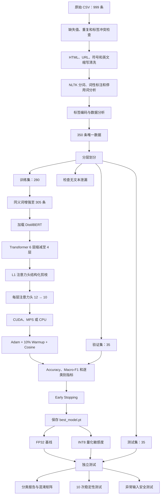

# 微软产品反馈文本分类项目最终报告

| 项目项 | 内容 |
|---|---|
| 项目名称 | 微软产品反馈轻量化文本分类 |
| 最终模型 | 四层 L1 注意力头结构化剪枝 DistilBERT |
| 分类任务 | 英文文本三分类 |
| 文档版本 | 1.0 |
| 更新日期 | 2026-06-29 |
| 支持平台 | macOS、Windows、Linux |

## 1 项目摘要

本项目面向微软产品相关英文用户反馈，构建一个轻量化三分类文本模型，将输入
划分为投诉建议、功能反馈和问题咨询。项目覆盖原始数据质量检查、文本清洗、
数据分析、分层划分、同义词增强、DistilBERT 微调、模型缩层、L1 注意力头
结构化剪枝、动态量化、独立测试、稳定性测试和异常输入安全控制。

最终 FP32 结构化剪枝模型在 35 条独立测试数据上取得 94.29% Accuracy 和
0.9389 Weighted-F1。全 Linear INT8 模型保持相同测试 Accuracy，模型文件由
195.36 MB 减少至 117.19 MB，体积下降 40.01%。Apple Silicon 的 QNNPACK
后端未带来速度提升，因此 Mac 部署建议优先使用 FP32 + MPS，INT8 作为
体积优先方案。

## 2 项目目标与完成情况

| 目标 | 验收标准 | 实际结果 | 状态 |
|---|---:|---:|---|
| 分类准确率 | Accuracy ≥ 88% | 94.29% | 通过 |
| 模型压缩 | 文件体积降低 ≥ 30% | 降低 40.01% | 通过 |
| 推理加速 | 相比 FP32 提升 ≥ 25% | 速度变化 -198.20% | 未通过 |
| 稳定性 | 核心指标波动 ≤ 3% | Accuracy/F1 波动 0 | 通过 |
| 异常输入 | 不崩溃且不强制输出业务标签 | 12/12 无崩溃，全部拦截或复核 | 通过 |

速度目标未通过是平台量化后端差异导致的真实结果。QNNPACK 在当前 Apple
Silicon 上执行全 Linear 动态量化的开销高于 FP32。项目保留该结果，没有将
Windows/x86 的 INT8 加速结论直接套用到 Mac。Windows 部署应使用 FBGEMM
后端重新执行量化性能测试。

## 3 分类定义

| 标签编号 | 类别名称 | 业务含义 |
|---:|---|---|
| 0 | `complaint_suggestion` | 产品投诉、使用体验问题和改进建议 |
| 1 | `feature_feedback` | 新功能请求、现有功能评价和功能反馈 |
| 2 | `problem_consultation` | 安装、登录、账号、密码及使用问题咨询 |

标签映射保存在：

```text
outputs/source_data/label_mapping.json
```

## 4 技术环境

### 4.1 核心依赖

| 软件或库 | 版本 |
|---|---:|
| Python | 推荐 3.11 |
| PyTorch | 2.8.0 |
| Transformers | 4.57.6 |
| pandas | 2.3.3 |
| NumPy | 2.0.2 |
| scikit-learn | 1.6.1 |
| NLTK | 3.9.2 |
| BeautifulSoup4 | 4.15.0 |
| tqdm | 4.68.3 |

完整版本固定在 `requirements.txt`。

### 4.2 跨平台设备选择

训练设备按以下顺序自动选择：

```text
CUDA → Apple MPS → CPU
```

动态量化后端按硬件自动选择：

```text
Apple ARM：QNNPACK
Windows/Linux x86：x86 或 FBGEMM
```

## 5 项目目录

```text
final/
├── data/
│   └── raw/
│       └── microsoft_text_classification_data.csv
├── outputs/
│   ├── source_data/
│   ├── data/
│   ├── logs/
│   ├── checkpoints/
│   ├── quantization/
│   ├── test_results/
│   ├── stability_results/
│   └── abnormal_input_results/
├── augmentation.py
├── data_analysis.py
├── data_quality.py
├── dataset.py
├── evaluate_final_model.py
├── evaluate_input_safety.py
├── evaluate_quantization.py
├── evaluate_stability.py
├── evaluation.py
├── model.py
├── nltk_resources.py
├── prepare_data.py
├── prepare_source_data.py
├── preprocessing.py
├── run_experiments.py
├── run_pipeline.py
├── runtime.py
├── text_cleaning.py
├── train_final_model.py
├── training.py
├── requirements.txt
└── README.md
```

## 6 数据处理流程说明

### 6.1 原始数据质量

| 项目 | 数量 |
|---|---:|
| 原始数据 | 999 |
| 完全重复数据 | 649 |
| 去重后唯一数据 | 350 |
| 缺失文本或标签 | 0 |
| 同文本多标签冲突 | 0 |

缺失值处理策略为删除缺少 `text` 或 `category` 的记录。标签冲突处理策略为
删除同一文本对应多个类别的全部冲突记录，避免模型收到互相矛盾的监督信号。

### 6.2 文本清洗

`text_cleaning.py` 按以下顺序处理文本：

1. 使用 BeautifulSoup 删除 HTML 标签
2. 使用正则表达式删除 URL
3. 规范 `can't`、`won't`、`n't` 等英文缩写
4. 删除英文所有格产生的冗余 `'s`
5. 删除非字母、非数字和非空格字符
6. 合并连续空格并清除首尾空格
7. 将文本转换为小写

缩写处理可避免 `can't → can t`、`Microsoft's → microsoft s` 产生无意义的
高频词 `t` 和 `s`。

### 6.3 NLTK 处理

`preprocessing.py` 完成：

- 英文分词
- 词性标注
- 英文停用词处理
- 文本长度统计
- 类别数字编码

NLTK 结果用于数据理解和统计分析。模型训练仍使用完整 `clean_text`，并由
DistilBERT Tokenizer 重新执行子词编码，不直接使用 NLTK Token 作为模型输入。

### 6.4 文本长度分析

| 类别 | 样本数 | 平均 Token 数 | 去停用词后平均 Token 数 | 平均移除数 |
|---|---:|---:|---:|---:|
| 投诉建议 | 84 | 8.92 | 6.08 | 2.83 |
| 功能反馈 | 46 | 9.91 | 6.78 | 3.13 |
| 问题咨询 | 220 | 8.99 | 5.41 | 3.58 |

所有类别最大文本长度为 13 个 NLTK Token，模型设置 `max_length=128` 足以覆盖
当前数据，同时为后续更长输入保留空间。

### 6.5 类别分布

| 类别 | 样本数 | 比例 |
|---|---:|---:|
| 投诉建议 | 84 | 24.00% |
| 功能反馈 | 46 | 13.14% |
| 问题咨询 | 220 | 62.86% |
| 合计 | 350 | 100% |

数据存在类别不均衡，因此项目除 Accuracy 外，同时记录 Macro-F1 和每个类别
的 Precision、Recall、F1。

### 6.6 最终数据划分

采用固定随机种子和分层抽样：

| 数据集 | 数量 | 比例 | 用途 |
|---|---:|---:|---|
| 训练集 | 280 | 80% | 反向传播和参数更新 |
| 验证集 | 35 | 10% | 早停、最佳模型选择和量化方案比较 |
| 独立测试集 | 35 | 10% | 最终验收 |

程序会检查三个数据集的文本交集。当前训练、验证和测试集之间的文本重叠均为
0，没有发现文本级数据泄漏。

### 6.7 数据增强

训练阶段从训练集抽取 30% 样本尝试同义词替换。实际新增 25 条有效增强数据：

```text
原始训练集：280
增强后训练集：305
验证集和测试集：保持不变
```

否定词、疑问词和情态词被列入保护集合，避免同义词替换改变原句意图。

## 7 模型构建与优化步骤

### 7.1 基础模型

基础模型为 `distilbert-base-uncased`，原始结构包含：

- 6 个 Transformer 层
- 每层 12 个注意力头
- 隐藏维度 768
- 三分类任务输出层

### 7.2 模型缩层

通过 `config.n_layers=4` 将 Transformer 层数从 6 层减少为 4 层。模型参数量
由 66,955,779 降至 52,780,035。

### 7.3 L1 注意力头结构化剪枝

程序对每层每个注意力头的 Q、K、V 和输出投影权重计算 L1 范数：

```text
重要性分数 =
|Q 权重|之和 + |K 权重|之和 + |V 权重|之和 + |输出权重|之和
```

每层物理删除分数最低的两个注意力头：

```text
每层注意力头：12 → 10
注意力头总数：72 → 40
```

剪枝后最终模型参数量为 51,205,635。

| 模型结构 | 参数量 | 相比原始模型减少 |
|---|---:|---:|
| 原始六层 DistilBERT 三分类模型 | 66,955,779 | 0% |
| 四层未剪枝模型 | 52,780,035 | 21.17% |
| 四层 + L1 注意力头剪枝模型 | 51,205,635 | 23.52% |

### 7.4 分类头

模型最终输出三个 logits，对应三个业务类别。训练时使用 CrossEntropyLoss，
推理时取最高 logit 对应类别。安全推理层会进一步执行输入校验、置信度判断和
领域信号判断，避免无意义输入被强制接受为业务标签。

## 8 参数配置清单

| 参数 | 最终值 | 作用 |
|---|---:|---|
| 基础模型 | `distilbert-base-uncased` | 英文预训练模型 |
| 类别数量 | 3 | 三分类任务 |
| Transformer 层数 | 4 | 模型缩层 |
| 每层剪枝头数 | 2 | L1 结构化剪枝 |
| 剪枝后每层头数 | 10 | 降低注意力计算量 |
| 最大序列长度 | 128 | Tokenizer 截断与补齐 |
| Batch Size | 32 | 每次梯度更新使用的样本数 |
| 最大 Epoch | 20 | 最大训练轮数 |
| 学习率 | `1e-5` | Adam 初始学习率 |
| 优化器 | Adam | 参数更新 |
| Weight Decay | 0.001 | 降低过拟合 |
| Dropout | 0.2 | 分类和隐藏层正则化 |
| Attention Dropout | 0.2 | 注意力层正则化 |
| 数据增强比例 | 0.3 | 同义词增强采样比例 |
| Scheduler | Warmup + Cosine | 学习率调度 |
| Warmup Ratio | 0.10 | 前 10% 步数逐渐升高学习率 |
| Early Stopping Patience | 5 | 连续 5 轮无提升后停止 |
| Early Stopping Min Epochs | 8 | 前 8 轮不触发早停 |
| 随机种子 | 42 | 数据划分和增强复现 |
| 置信度阈值 | 0.60 | 低于阈值转人工复核 |

可通过 `train_final_model.py` 参数覆盖 scheduler、warmup ratio、weight decay、
batch size 和 epochs。`run_experiments.py` 提供批量超参数对比入口。

## 9 训练日志与结果分析

与当前打包 `best_model.pt` 对应的训练日志为：

```text
outputs/logs/final_training_log.csv
```

训练共完成 14 轮。最佳验证结果出现在第 9 轮：

| 指标 | 第 1 轮 | 最佳第 9 轮 | 最后第 14 轮 |
|---|---:|---:|---:|
| Train Loss | 1.0848 | 0.3378 | 0.1776 |
| Validation Accuracy | 62.86% | 94.29% | 94.29% |
| Validation Weighted-F1 | 0.4852 | 0.9389 | 0.9389 |
| Validation Macro-F1 | 0.2573 | 0.8796 | 0.8796 |

第 9 轮之后训练 Loss 继续下降，但验证集 Accuracy 没有进一步提高，说明继续
训练只改善了训练集拟合，没有带来验证泛化收益。连续 5 轮无提升后，第 14 轮
触发 Early Stopping。最终测试加载第 9 轮保存的 `best_model.pt`，而不是最后
一轮的 `latest_model.pt`。

最佳验证集逐类别指标：

| 类别 | Precision | Recall | F1 |
|---|---:|---:|---:|
| 投诉建议 | 0.8000 | 1.0000 | 0.8889 |
| 功能反馈 | 1.0000 | 0.6000 | 0.7500 |
| 问题咨询 | 1.0000 | 1.0000 | 1.0000 |

功能反馈类别 Recall 较低，主要原因是该类别仅有 46 条完整数据、验证集中仅有
5 条，是当前最需要扩充的数据类别。

## 10 量化性能对比报告

量化敏感度结果保存在：

```text
outputs/quantization/quantization_sensitivity_comparison.csv
```

当前 Apple Silicon + QNNPACK 环境结果：

| 模型 | 大小 MB | Accuracy | F1 | 每轮推理秒数 | 体积降低 | 速度变化 |
|---|---:|---:|---:|---:|---:|---:|
| FP32 四层结构化剪枝 | 195.36 | 94.29% | 0.9389 | 0.2081 | 0% | 0% |
| INT8 全 Linear | 117.19 | 94.29% | 0.9389 | 0.6184 | 40.01% | -197.10% |
| INT8 仅 Attention | 172.88 | 94.29% | 0.9389 | 0.3319 | 11.51% | -59.44% |
| INT8 仅 FFN | 141.37 | 94.29% | 0.9389 | 0.4998 | 27.64% | -140.10% |
| INT8 仅 Classifier | 193.67 | 94.29% | 0.9389 | 0.2086 | 0.87% | -0.22% |

所有量化方案均保持验证集精度，但没有方案在当前 Mac 后端获得正向速度收益。
全 Linear INT8 体积最小，适用于体积优先场景；FP32 + MPS 更适合 Mac
速度优先场景。Windows x86/FBGEMM 需要重新运行该表，不能直接沿用 Mac 速度。

## 11 独立测试报告

最终测试结果保存在：

```text
outputs/test_results/final_test_results.csv
outputs/test_results/final_test_summary.csv
```

### 11.1 总体指标

| 模型 | Accuracy | Precision | Recall | Weighted-F1 | 大小 MB |
|---|---:|---:|---:|---:|---:|
| FP32 四层结构化剪枝 | 94.29% | 0.9543 | 0.9429 | 0.9389 | 195.36 |
| INT8 全 Linear | 94.29% | 0.9543 | 0.9429 | 0.9389 | 117.19 |

### 11.2 逐类别指标

FP32 与 INT8 在当前测试集上的分类结果一致：

| 类别 | Precision | Recall | F1 | 测试样本数 |
|---|---:|---:|---:|---:|
| 投诉建议 | 0.8000 | 1.0000 | 0.8889 | 8 |
| 功能反馈 | 1.0000 | 0.6000 | 0.7500 | 5 |
| 问题咨询 | 1.0000 | 1.0000 | 1.0000 | 22 |
| Macro Avg | 0.9333 | 0.8667 | 0.8796 | 35 |
| Weighted Avg | 0.9543 | 0.9429 | 0.9389 | 35 |

### 11.3 混淆矩阵

行表示真实类别，列表示预测类别：

| 真实\预测 | 投诉建议 | 功能反馈 | 问题咨询 |
|---|---:|---:|---:|
| 投诉建议 | 8 | 0 | 0 |
| 功能反馈 | 2 | 3 | 0 |
| 问题咨询 | 0 | 0 | 22 |

35 条测试数据中共错分 2 条，均为功能反馈被预测为投诉建议。该结果进一步说明
功能反馈类别的数据量和表达覆盖范围需要扩充。

## 12 稳定性测试报告

稳定性脚本对同一 INT8 模型和测试集重复推理 10 次。

| 指标 | 均值 | 标准差 | 最小值 | 最大值 | 范围 |
|---|---:|---:|---:|---:|---:|
| Accuracy | 0.942857 | 0 | 0.942857 | 0.942857 | 0 |
| Precision | 0.954286 | 0 | 0.954286 | 0.954286 | 0 |
| Recall | 0.942857 | 0 | 0.942857 | 0.942857 | 0 |
| F1 | 0.938889 | 约 0 | 0.938889 | 0.938889 | 0 |
| 整轮推理时间秒 | 0.628265 | 0.008527 | 0.619011 | 0.649601 | 0.030591 |

稳定性阈值为 3%。Accuracy、Recall、F1 的波动均为 0，十次运行的逐条预测完全
一致，`overall_stable=True`。推理时间存在正常的操作系统负载波动，但不影响
模型输出。

## 13 异常输入与安全控制报告

三分类模型本身无兜底类别，原始 argmax 对任何输入都会返回三个业务标签之一。
项目在模型外增加三层保护：

```text
输入格式校验
→ Softmax 置信度校验
→ 软件领域信号校验
→ 接受分类或转人工复核
```

安全规则：

- 空文本、纯符号、纯数字、键盘乱序等直接标记 `invalid_input`
- 最高类别概率低于 0.60 时标记 `low_confidence_review`
- 缺少软件领域信号时标记 `out_of_domain_review`
- 仅在全部检查通过后返回 `accepted_classification`

异常输入测试结果：

| 项目 | 数量 |
|---|---:|
| 测试案例 | 12 |
| 成功处理 | 12 |
| 运行失败 | 0 |
| 直接判定无效 | 7 |
| 低置信度人工复核 | 5 |
| 域外人工复核 | 0 |
| 接受为业务分类 | 0 |
| 拦截或复核总数 | 12 |

全部异常案例均未崩溃，也没有被盲目接受为业务分类。

## 14 项目完整工作流



## 15 运行与复现

### 15.1 macOS

```bash
cd final
python3.11 -m venv .venv
source .venv/bin/activate
python -m pip install -r requirements.txt
python run_pipeline.py
```

### 15.2 Windows PowerShell

```powershell
cd final
py -3.11 -m venv .venv
.\.venv\Scripts\Activate.ps1
python -m pip install -r requirements.txt
python run_pipeline.py
```

### 15.3 分阶段运行

```bash
python run_pipeline.py prepare
python run_pipeline.py train
python run_pipeline.py quantize
python run_pipeline.py test
```

不提供阶段参数时，默认按 `prepare → train → quantize → test` 顺序执行完整流程。

命令与内部脚本对应关系：

```text
prepare
├── prepare_source_data.py
└── prepare_data.py

train
└── train_final_model.py

quantize
└── evaluate_quantization.py

test
├── evaluate_final_model.py
├── evaluate_stability.py
└── evaluate_input_safety.py
```

## 16 输出文件与审核材料索引

### 16.1 数据处理材料

```text
outputs/source_data/cleaned_unique.csv
outputs/source_data/label_mapping.json
outputs/source_data/top_words_by_category.csv
outputs/source_data/text_length_summary_by_category.csv
outputs/source_data/split_distribution_check.csv
outputs/data/train.csv
outputs/data/val.csv
outputs/data/test.csv
```

### 16.2 模型与训练日志

```text
outputs/checkpoints/final_4layers_l1headpruned_cosine_aug_wd0001_bs32/best_model.pt
outputs/logs/final_training_log.csv
```

### 16.3 量化性能报告

```text
outputs/quantization/quantization_sensitivity_comparison.csv
```

### 16.4 独立测试报告

```text
outputs/test_results/final_test_results.csv
outputs/test_results/final_test_summary.csv
outputs/test_results/*_classification_report.csv
outputs/test_results/*_confusion_matrix.csv
outputs/test_results/*_predictions.csv
```

### 16.5 稳定性报告

```text
outputs/stability_results/stability_test_results.csv
outputs/stability_results/stability_summary.csv
outputs/stability_results/stability_final_summary.csv
```

### 16.6 异常输入报告

```text
outputs/abnormal_input_results/input_safety_results.csv
outputs/abnormal_input_results/input_safety_summary.csv
```

## 17 结论与局限

项目已完成数据处理、轻量化模型构建、结构化剪枝、训练优化、量化敏感度分析、
独立测试、稳定性测试和异常输入安全控制。最终模型达到准确率和压缩率要求，
并能够在 macOS、Windows 和 Linux 上运行。

当前局限：

1. 唯一数据仅 350 条，独立测试集仅 35 条，一条样本会引起约 2.86 个百分点变化
2. 功能反馈类别仅 46 条，Recall 为 0.60，是主要误差来源
3. 置信度阈值 0.60 尚未通过专门的概率校准实验确定
4. QNNPACK 在当前 Mac 上没有带来 INT8 速度提升
5. PyTorch 2.8 的旧动态量化接口将在后续版本弃用，升级前应迁移至 torchao

后续优化方向：

- 增加功能反馈类别数据并扩充表达方式
- 使用交叉验证评估小数据集方差
- 使用 Temperature Scaling 校准分类置信度
- 在 Windows FBGEMM 后端重新测试 INT8 性能
- 将动态量化迁移至 torchao

## 18 提交建议

直接提交本 `final` 文件夹即可。提交前不应包含本机虚拟环境和缓存：

```text
.venv/
__pycache__/
.idea/
.DS_Store
```

若提交平台限制文件大小，至少保留：

- 全部 `.py` 源代码
- `README.md`
- `requirements.txt`
- 原始数据及三个划分数据集
- `best_model.pt`
- `final_training_log.csv`
- 量化、测试、稳定性和异常输入 CSV 报告
